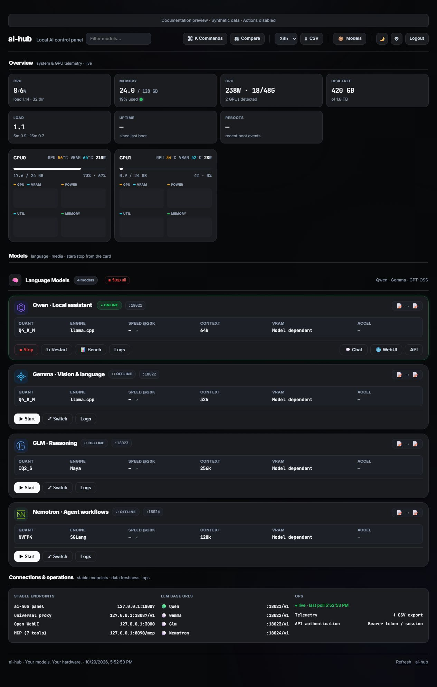

# ai-hub

**Your models. Your hardware. One control panel.**

A self-hosted control panel for a single AI server. Start and stop inference
services, inspect GPU usage, manage model downloads, and connect clients through
one OpenAI-compatible endpoint. A Go backend serves a vanilla JavaScript UI;
no frontend build step or database is required.

[Install](#quick-start) · [Connect a model](docs/models.md) ·
[Production setup](docs/operations.md) · [Configuration](docs/configuration.md) ·
[Security](SECURITY.md) · [Contribute](CONTRIBUTING.md)



*Real UI with synthetic documentation data, not measured model performance.
Explore it locally with `python scripts/demo.py`.*

## Features

- **Model lifecycle:** start, stop, restart, switch, inspect logs and health.
  Linux systemd services launch native processes or Docker containers.
- **One inference URL:** `/v1/models` and `/v1/chat/completions` follow the most
  recently started local LLM, with streaming and model readiness checks.
- **GPU and host monitoring:** memory, utilization, temperature, power, CPU/RAM,
  disk breakdown, telemetry history, CSV export, and Prometheus metrics.
- **Launch controls:** compatible profiles expose GPU count, context size,
  concurrent requests, and estimated memory feasibility.
- **Model inventory:** YAML download sources and paths, resumable downloads,
  and retained catalog entries when weights are removed.
- **Media integrations:** ComfyUI image/video workflows, speech, music and 3D;
  seven MCP tools connect to separately installed media services.
- **Operator tools:** filtering, command palette, model comparison, benchmarks,
  notifications, dark/light themes, and a responsive mobile layout.
- **Private defaults:** loopback listener, generated access token, authenticated
  inference/metrics/MCP, CSRF protection, and expiring browser sessions.

## Model families and backends

| | Family | Integration examples |
| --- | --- | --- |
|  | Qwen | llama.cpp, vLLM, configured native service |
|  | Gemma | llama.cpp |
|  | GLM | configured native service; legacy Maya profiles |
|  | Nemotron | llama.cpp or SGLang |
|  | GPT-OSS | llama.cpp |
|  | Image, video, voice, music, 3D | separately installed media services |

These are integration families, not a guarantee for every model, quantization,
GPU or engine version. The local SVG illustrations are original identifiers,
not official provider logos. Model licenses and memory requirements vary.

## Quick start

Requirements: **Go 1.26.10+** and **Python 3.10+**. Install Go from the
[official downloads](https://go.dev/dl/). Node.js 22+ is needed only for frontend
checks and optional client configuration generators.

Clone or download this repository, open its directory, and run:

```sh
# Linux
sh start.sh
```

```powershell
# Windows development
.\start.ps1
```

The launcher creates a private `.env` from `.env.example`, asks for a login
token, builds the panel, and starts it. Press Enter to generate a random token.
Open [http://localhost:8080](http://localhost:8080) and sign in using
`AIHUB_TOKEN` from `.env`. Keep that file private. Stop with Ctrl+C.

Fresh configuration uses empty registry/catalog examples. Follow the
[llama.cpp walkthrough](docs/models.md) to connect your first model. Starting
the panel does not install engines, drivers, or model weights.

Linux is required for real service control. Windows mocks service control and
can show simulated GPU data when NVIDIA tooling is unavailable; it does not
control a remote Linux host.

### Build without Python

```sh
cp .env.example .env
chmod 600 .env
go build -trimpath -o bin/aihub ./cmd/aihub
./bin/aihub
```

When `AIHUB_TOKEN` is empty, direct startup generates a random token in the
configured token file (default: `token` in the installation root, mode `0600`
on Linux). It logs the location, never the credential. Existing tokens persist.

## Connect a client

Start a model, then configure your OpenAI-compatible client:

| Setting | Value |
| --- | --- |
| Base URL | `http://localhost:8080/v1` |
| API key | Your private ai-hub access token |
| Model | `universal` |

From a shell where `AIHUB_TOKEN` is already set privately:

```sh
curl http://localhost:8080/v1/chat/completions \
  -H "Authorization: Bearer $AIHUB_TOKEN" \
  -H 'Content-Type: application/json' \
  -d '{"model":"universal","stream":true,"messages":[{"role":"user","content":"Hello!"}]}'
```

The proxy returns `503` when no model is available. Large models can take
several minutes to load. Hub credentials are not forwarded to inference
backends; native profiles can use private keys in `AIHUB_KEYS_DIR`.
Use HTTPS and the configured hostname for access from another machine.

## MCP media tools

```sh
go build -trimpath -o bin/mcp ./cmd/mcp
./bin/mcp                         # stdio for a local MCP client
./bin/mcp -http 127.0.0.1:8090    # HTTP with bearer authentication
```

HTTP clients use `http://localhost:8090/mcp` and
`Authorization: Bearer <your-ai-hub-token>`. Stdio uses the launching process's
permissions. MCP loads the same `.env`; flags override media settings.

Tools: `generate_image`, `generate_video`, `text_to_speech`, `speech_to_text`,
`generate_music`, `image_to_3d`, and `media_status`. Their inference services
and weights must already be installed. Limit accessible files with
`-read-roots`; see [configuration](docs/configuration.md).

## Deployment and support boundary

Follow [Linux installation and operations](docs/operations.md) for a fresh host.
For an existing compatible installation:

```sh
python scripts/deploy.py --dry-run
python scripts/deploy.py
```

The destination comes from private `.env` settings. Deployment is explicit;
ordinary builds/tests never connect to your server.

ai-hub is a **single-administrator, single-host control plane** with host-level
service privileges. Keep it behind a trusted network or HTTPS access gateway.
It does not provide multi-tenant isolation, user roles, quotas, distributed
scheduling, or public inference billing.

Reference profiles in `registry.yaml` and specialized Strata/Maya/media scripts
have installation-specific paths and engine assumptions. They are optional;
the empty first-run examples are the recommended starting point. Validate
hardware integration and model performance on your own machine.

## Development

```sh
python -m pip install -r requirements-dev.txt
python scripts/check.py
```

The gate runs Go vet/build/tests, bootstrap tests, JavaScript syntax/behavior
checks, CSS synchronization, and the historical Python/Go shared API contract.
CI also runs the race detector on Linux, vulnerability checks and a Git secret scan.

```sh
go test -race -count=1 -timeout 120s ./...
go run golang.org/x/vuln/cmd/govulncheck@v1.9.0 ./...
```

See [CONTRIBUTING.md](CONTRIBUTING.md), [architecture](docs/architecture.md),
[third-party notices](THIRD_PARTY_NOTICES.md), and the
[release checklist](docs/releasing.md). Project prose, comments and UI are in
English; recorded prompts and Unicode tests retain their original language.

## License

A license for the project code has not yet been selected. Do not assume a
reuse grant until a `LICENSE` file is added. Third-party components and model
weights retain their own terms; no weights are distributed here.
