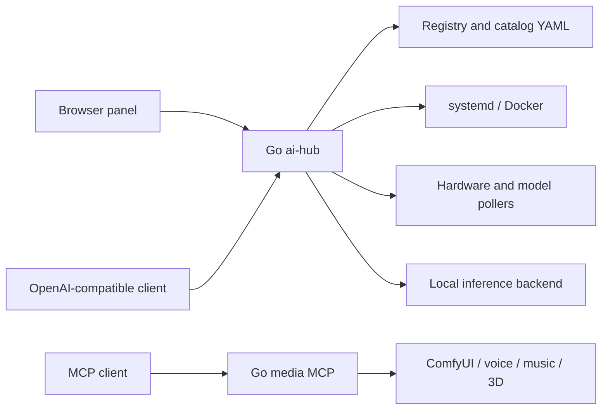

# Architecture

The panel owns lifecycle and status, not inference. Pollers maintain a snapshot
and bounded telemetry history; freshness exposes stalled polling. Universal
selects the latest-started LLM, waits for readiness and flushes streamed output
without an overall write deadline.

`cmd/aihub` composes configuration, auth, registry, lifecycle, pollers and routes.
`cmd/mcp` exposes independent media tools. `internal/` contains backend packages;
`static/` is the browser UI; `examples/` provides first-run configuration.
There is no database or mandatory JavaScript package manager.

The root registry and specialized directories preserve reference integrations.
Fresh `.env.example` does not enable them. A YAML catalog can replace the legacy
compiled inventory without recompilation.

Boundaries: one host/admin, privileged panel, in-memory sessions, no durable
audit trail or distributed scheduler, optional hardware-specific diagnostics.
Treat model/provider metadata as trusted configuration. The browser script
policy still permits the existing inline UI handlers.
